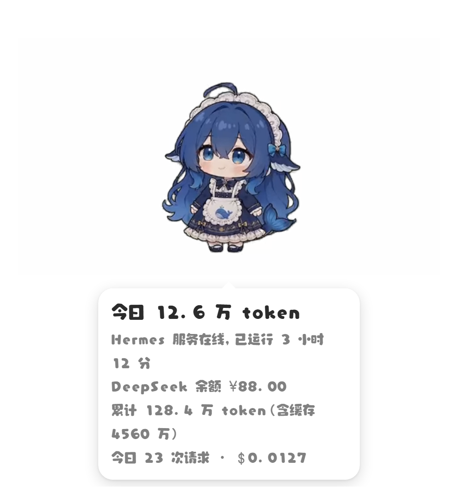

# dsh-pet-hermes

把 [dsh-pet](https://github.com/PC2005-cloud/dsh-pet) 桌宠**换绑到本地 Hermes 服务**。

Hermes 网关服务在跑，桌宠就出现；服务一停，它自己消失。头顶气泡显示用量与余额，
右键能打开 Hermes 面板、让它碎碎念、跟它聊天。

> 同系列的另一件作品：[dsh-pet-ccswitch](https://github.com/cloud666666666/dsh-pet-ccswitch)（作者 Joker.Yun）
> —— 把同一只桌宠绑到 CC Switch。本包的宿主骨架来自它，跟随对象与数据源换成了 Hermes。
> 相比上一版的一行余额，这一版气泡是 5 行，而且会说出「这一轮在干什么」。

---

## 效果预览

**用量气泡** —— 右键「查看用量与余额」随时叫出来



**工作状态** —— 不再只说"在干活"，而是说出「刚跑完 `write_file`」


---

## 它做什么

| 能力 | 说明 |
|---|---|
| **跟随服务起落** | 盯着 Hermes 网关服务（`gateway run`）的生命周期：服务在跑就出现，停了就消失 |
| **5 行用量气泡** | 今日 token 增量 / 服务状态 / DeepSeek 余额 / 累计用量 / 今日请求数与花费 |
| **工作状态叙事** | 6 档状态 + 一句话说清这一轮在干什么（从"在干活"升级到"在写 xxx.md"） |
| **右键菜单** | 打开 Hermes 面板 · 查看用量与余额 · 碎碎念 · 对话 · 回到初始位置 · 退出桌宠（另有动作 / 动画点播） |
| **碎碎念 · 对话** | 直连 DeepSeek，**只在你点菜单时才调用** —— 不点不花钱 |
| **数据只读** | 全部取自 Hermes 自己的文件与接口，不改它一个字节 |

---

## 安装

**前提**：Windows · Node ≥ 22.5 · Hermes 装在 `C:\Hermes`（或设 `HERMES_HOME`）

```bash
npx github:LindaCasablanca/pet install
```

`install` 一次做完：还原 dsh-pet 原生包 → 打补丁 → 备好 Electron → 同步到运行目录
→ 注册开机自启 → 启动。首次会下载 dsh-pet 插件（约 65MB）与 Electron（约 100MB）。

> 本包**尚未发布到 npm registry**，所以要用 `npx github:` 的写法；发布后可直接 `npx dsh-pet-hermes`。

### 常用命令

| 命令 | 作用 |
|---|---|
| `install` | 一次性准备并启动 |
| `start` / `stop` / `restart` | 启停宿主（宿主会带着桌宠一起） |
| `status` / `doctor` | 自检：Hermes 在哪、库能不能读、补丁齐不齐、缺什么 |
| `patch` | 升级 dsh-pet 后重新打补丁（`--restore` 先从原生包整份还原） |
| `uninstall` | 移除开机自启（`--purge` 连运行数据一起删，会先备份配置） |

`start --with-hermes` 会顺手把 Hermes 网关服务也拉起来。

### 升级

- **升级本包**：重跑一遍 `install`。
- **升级 dsh-pet**：改 `package.json` 里 `dsh-pet` 的版本、重新 `install`。
  注意 **0.x 的 `^` 只放行同一 minor**（`^0.2.11` 装不到 `0.3.x`，必须显式改成 `^0.3.6`）。

> **当前适配：dsh-pet 0.3.6** —— 15 条补丁规则照 0.3.6 的产物逐字校对过，实测 15/15 命中。

0.3.x 相比 0.2.x 有几处**破坏性改动**，所以这次升级不只是改个版本号：

| 上游改动 | 影响 |
|---|---|
| 余额模型重构：`toBalanceState()` 按 `shape` 分流，且**白名单构造** | 不声明 `shape: "money"` 就整块返回 `null`，**气泡直接消失**；宿主多下发的扩展字段也不会自动带出来 |
| `total` 字段**语义变了**：0.2.x 是「今日 token」，0.3.x 是「余额金额」 | 今日用量不能再借旧字段，只能另起 `todayTokens` 等新名 |
| 删掉了 `deepseekPricingTier()`，改成服务端给 `state.tier` | 峰谷那三行用不成（DeepSeek 官方接口本来也不返回 tier），气泡改为铺自己的 5 行 |
| 原生 `balancePercent` 改按「余额 ÷ 额度上限」算 | 我们的同名补丁规则删掉了 —— 上游已经做了我们要的事 |
| `config.jsonc` 的 `workStatusEnabled` 默认改成 `true` | 同上，这条补丁规则也删掉了 |

如果你把它装到别的 dsh-pet 版本上：补丁认不出原文时会**告警并退化成原版行为**，不会把桌宠弄坏。
`node bin/cli.mjs patch --restore` 可以先从原生包整份还原再重打。

装之前想先知道"打不打得上去"，用体检工具（只读，不碰安装目录）：

```bash
node tools/check-patch.mjs --apply
```

它报两层：**① 锚点命中**（可打 / 已打 / 认不出）+ **② 产物语法**。
`--apply` 会在临时副本上真打一遍再校验 —— 因为**锚点命中 ≠ 产物正确**，只有②过了才算数。
认不出 > 0 说明上游改了这些位置，得按新版本重对锚点。

---

## 往哪升级

终极形态是 **「桌宠独立版 + Provider 接口」**：

```text
桌宠  ←  宿主（只认接口，不认具体服务）  ←  Provider 接口  ←  hermes / ccswitch / ...
```

桌宠和宿主都不认具体服务，Hermes 退化成 Provider 的一个实现 —— **换服务 = 换一个文件**。

接口草案（6 个方法 + 路由清单）已经写好。
**当前这一版仍是直连 Hermes 的实现，改造还没开始。**

---

## 关于凭证

**本包不含任何 API key，也不往任何地方写 key** —— 代码里只有「读」，没有硬编码兜底。

要让桌宠能查余额、能碎碎念，你需要自己准备一个 DeepSeek key。两种加法，前者优先：

| 加法 | 怎么做 |
|---|---|
| 设环境变量 | 给运行桌宠的进程设 `DEEPSEEK_API_KEY=sk-...` |
| 写进 Hermes 的 `.env` | 在 Hermes 安装目录的 `.env` 里加一行 `DEEPSEEK_API_KEY=sk-...` |

包就从这两处读。Hermes 安装目录按顺序找：环境变量 `HERMES_HOME` → `C:\Hermes` → `~\.hermes`。

读到的 key 只做两件事：查 DeepSeek 余额、调用碎碎念 / 对话。
所以**谁用谁自己的 key，花的是谁的钱**。

没配 key 也能用：桌宠本体、工作状态、右键菜单都照常，只有「查看用量与余额」和「碎碎念 / 对话」两项不可用。
跑 `doctor` 能看到读没读到（只报长度，不回显）。

---

## 想改代码 / 排障

内部实现、踩过的坑、自验方法、以及换台机器可能不一样的地方，都在
[`docs/implementation-notes.md`](docs/implementation-notes.md)。

---

## 出处与致谢

这只桌宠本身不是我写的，本包做的是「换绑」。三层署名：

| 层 | 作者 | 本包用了它什么 |
|---|---|---|
| [dsh-pet](https://github.com/PC2005-cloud/dsh-pet) | Gavin Wang (ooboqoo) | 桌宠本体、美术素材与动画。本包只在它的**构建产物上打补丁**，不修改、不重新分发其源码，也未内嵌其素材 |
| [dsh-pet-ccswitch](https://github.com/cloud666666666/dsh-pet-ccswitch) | Joker.Yun | 本包 `host.mjs` / `patch.mjs` / `cli.mjs` / `paths.mjs` 骨架的来源 |
| dsh-pet-hermes（本包） | LindaCasablanca | Hermes 数据层、工作状态叙事、自验工具链 |

三部分均以 MIT 发布，完整声明见 [`LICENSE`](LICENSE)。

License: MIT
